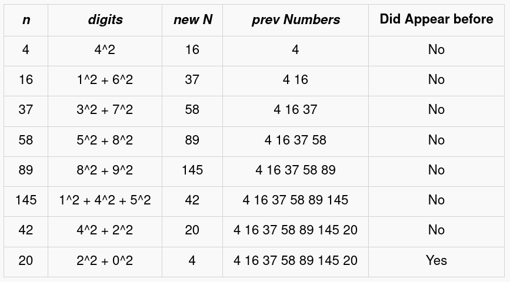

---
theme:
  name: catppuccin-mocha

  override:
    intro_slide:
      title:
        style: template
        font_size: 5
        height: 20
        
        

title: "**Happy _Numbers_ :)**"
sub_title: (Hoppy)
authors:
  - Hashir (26L-0558)
  - Uzair (26L-0582)
  - Ayaan (26L-0555)
---

What are happy numbers
===
A number whose digits' sum of squares eventually adds up to 1.

---
# Examples:

> 5 squares to 25
> 25 digts' square to 4 + 25 = 29
> 29 evaluates to 89 and so on... (never reaches 1)

But!!!
> 19 evaluates to 82
> 82 to 68, 68 to 100
> and 100 to 1 (yay! reached 1)

<!-- end_slide -->
So... How do we code it?
========================

Let us start with a basic function. Which returns true when its happy and false
when it is not.

<!-- column_layout: [2,1] -->
<!-- column: 0 -->
```file +line_numbers +exec  {1|2,20|3|5-7|9-13|15-17|18|19|all} +id:bad_code 
path: bad_code.cpp
language: cpp
```
<!-- column: 1 -->
<!-- snippet_output: bad_code -->

<!-- end_slide -->

Shortcomings of initial solution
===

What if it is not a happy number?

---
# Edge case
```cpp
checkHappy(4); // It gets stuck in an infinite loop
```
We get
```
4 -> 16 -> 37 -> 58 -> 89 -> 145 -> 42 -> 20 -> 4 -> 16 -> 37 ...
```

# Key Insight

> It can get stuck in an infinite loop.

<!-- end_slide -->

New Alogrithim
===

We keep track of previous numbers!

---
Just checking if n is repeating we can prevent infinite loops.

<!-- end_slide -->
A working program
===


<!-- column_layout: [2,1] -->
<!-- column: 0 -->
```file +line_numbers +exec  {1|2|6|8-23|24-27|29|all} +id:good_code 
path: good_code.cpp
language: cpp
```
<!-- column: 1 -->
<!-- snippet_output: good_code -->

<!-- end_slide -->

Questions!!!!
===

> Feel Free to ask any questions :3

Made with Love.

Almost forgot this function's body

```file +line_numbers 
path: happy.cpp
language: cpp
start_line: 69
end_line: 74
```
